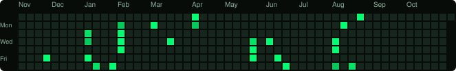

# demonala

**Hendry Rokkean Hery** · Papar, Sabah, Malaysia  
Founder and Lead Developer at **Absolute Immortal Inc.**

Software developer and security researcher building interactive 3D web engines, network recon tooling, and embedded hardware utilities.

```bash
┌──(demonala㉿absolute-immortal)-[~]
└─$ whoami --verbose
[+] identity   : Hendry Rokkean Hery (demonala)
[+] enterprise : Absolute Immortal Inc.
[+] location   : Papar, Sabah, Malaysia
[+] focus      : 3D WebGL / Network Recon / Embedded Hardware
[+] status     : iam not real
```

---

### Activity

<p align="center">
  
</p>

---

### Focus & Systems

- **3D Graphics and Games:** WebGL raycasting, retro canvas engines, and browser survival games (including *Don't Mess With Him*).
- **Network and Recon Tooling:** Python utilities for OSINT, IP metadata inspection, and endpoint auditing.
- **Embedded and Hardware:** Headless automation, network monitoring, and sensor integration on Raspberry Pi Zero.
- **Desktop and Media:** Audio-reactive visualizers and live wallpaper engines hooked into media players.

---

### Repositories

| Repository | Tech | Description |
| :--- | :--- | :--- |
| **[IP-DIGGER](https://github.com/demonala/IP-DIGGER)** | Python | Fast IP metadata and network reconnaissance utility. |
| **[NightCrawler-](https://github.com/demonala/NightCrawler-)** | Python | Network recon and OSINT script tailored for mobile and Linux environments. |
| **[Spotify-Wallpaper-Player](https://github.com/demonala/Spotify-Wallpaper-Player)** | JavaScript | Desktop wallpaper player syncing ambient visuals with Spotify playback. |
| **[For-me-Pi-zero](https://github.com/demonala/For-me-Pi-zero)** | Python, Shell | Automation, system daemons, and experiments on Raspberry Pi Zero. |
| **[Kjagu-Development-State](https://github.com/demonala/Kjagu-Development-State)** | Python | Security research exploring threat detection and anti-spyware telemetry. |
| **[abouthendry](https://github.com/demonala/abouthendry)** | WebGL, HTML | Personal site featuring an interactive 3D Nextbot maze survival game. |

---

### Arsenal

- **Languages:** Python, C++, JavaScript, TypeScript, Bash, PowerShell
- **Platforms:** Linux (Debian, Kali), Raspberry Pi OS, Windows
- **Graphics and Audio:** WebGL, Three.js, Canvas API, Web Audio API
- **Networking:** Scapy, raw sockets, Wireshark, Nmap

---

<div align="right">
  <sub>Absolute Immortal Inc.</sub>
</div>
